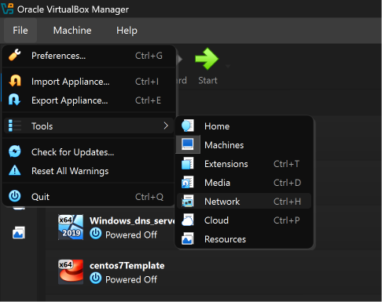
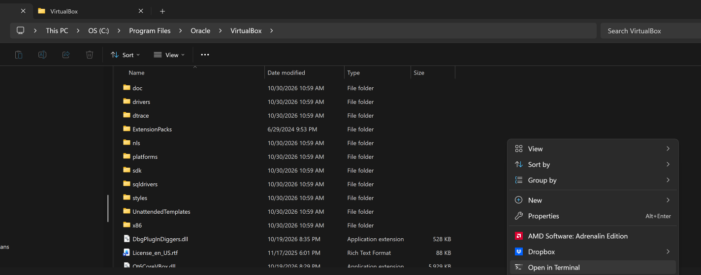
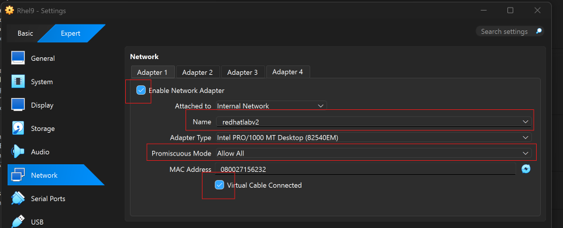
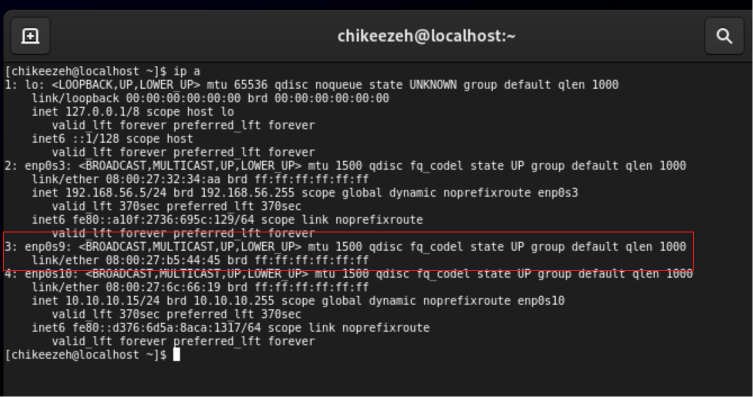
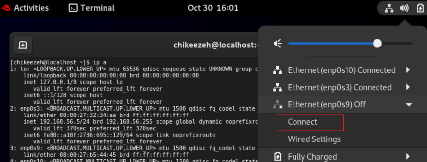
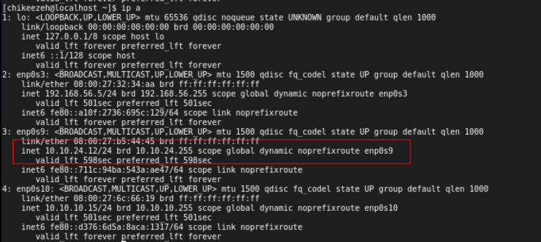
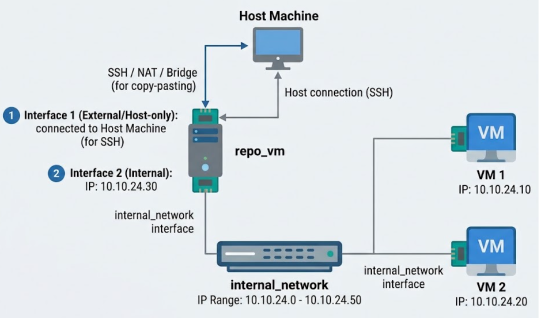
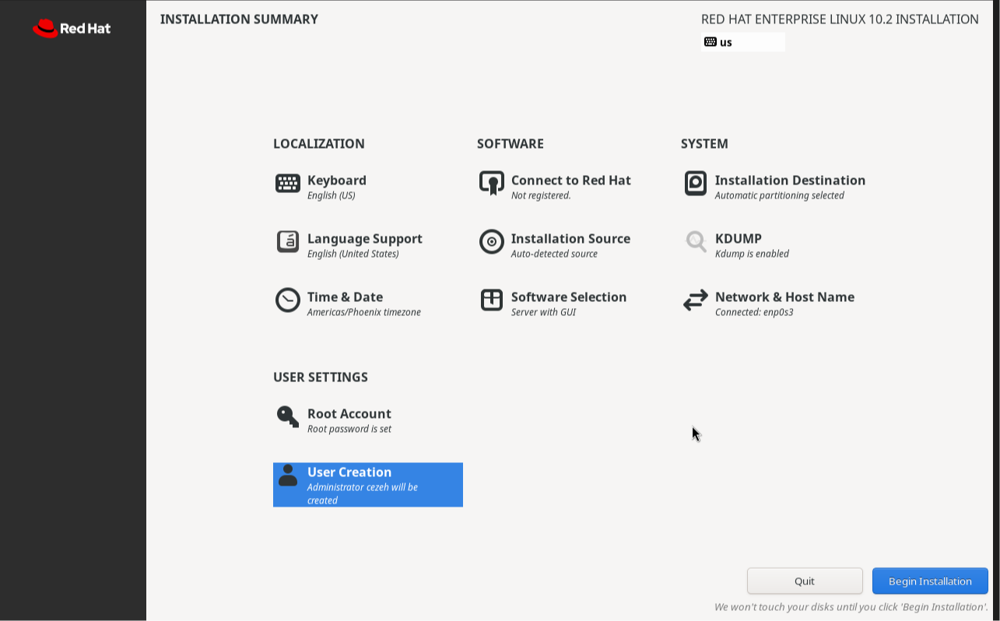
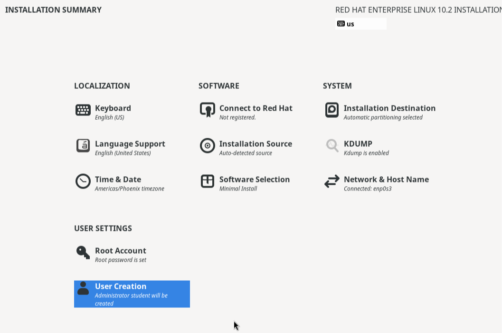

#### Network Setup

We will need 2 interfaces on VirtualBox.



Host-only Adapter inferface on one VM that will be our jump box, and repository server.

A new internal network created with the command below, run on your Host machine (The computer running virtualBox), make sure to run from the installation location of your virtualbox. 

For my default installation, the location is: `C:\Program Files\Oracle\VirtualBox`, drop the location in the address bar of File Explorer, then right click and open in Terminal.



Then copy and paste the command below to create an internal network.


`.\VBoxManage.exe dhcpserver add --netname "redhatlabv2" --ip 10.10.24.1 --netmask 255.255.255.0 --lowerip 10.10.24.10 --upperip 10.10.24.50 --enable`

In virtualbox, on any of your VM that needs the internal network, power it down, then go to the network settings and configure it as shown below. Note, you will need to type out the netname you created above.



##### Network Troubleshooting.

If the host doesn't have an IP yet, it might be due to the interface not been connected. You will need to turn that interface on, if the VM is a GUI machine, it is easy to turn on as shown in the second image.





Once you click connect, the VM should grab an IP in the given subnet range.



#### Lab configuration.

We will have a simple lab as shown below.




##### repo_vm



Interface 1: `Host-only Adapter` 
* IP: Will depend on default values, will configure it to be static.

Interface 2: `Internal Network`
* IP: 10.10.24.30/24

Hostname: `repo.rhcsa.lab`

##### VM1



Interface 1: `Internal Network`
* IP: 10.10.24.10/24

Hostname: `vm1.rhcsa.lab`

OS: Rhel10 minimal install

##### VM2

Interface 1: `Internal Network`
* IP: 10.10.24.20/24

Hostname: `vm2.rhcsa.lab`

OS: Rhel10 minimal install

##### Host name resolution

We will add the content below to `/etc/hosts` so we can use hostnames instead of IP addresses to connect between servers. Edit on one host and `scp` to the other hosts.

```json
10.10.24.30 repo.rhcsa.lab repo
10.10.24.10 vm1.rhcsa.lab vm1
10.10.24.20 vm2.rhcsa.lab vm2
```

#### Repository Setup.

We will follow the steps in this [guide](https://github.com/chikeezeh/rhcsa_study_note/blob/master/notes/labcreation.md) to turn our GUI Rhel10 server into a repository, so we can use it to install packages on itself and the other VMs.

##### Troubleshoo

